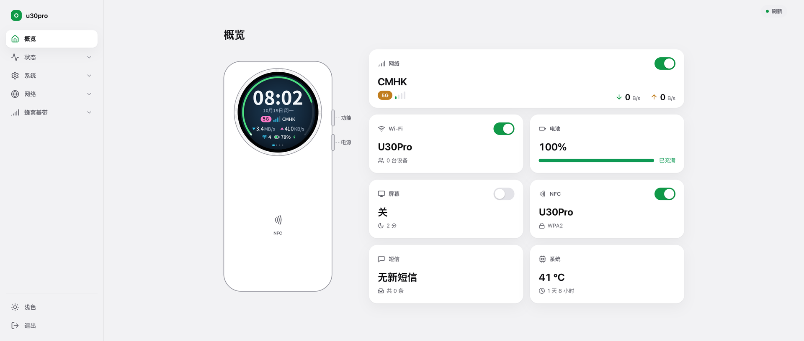
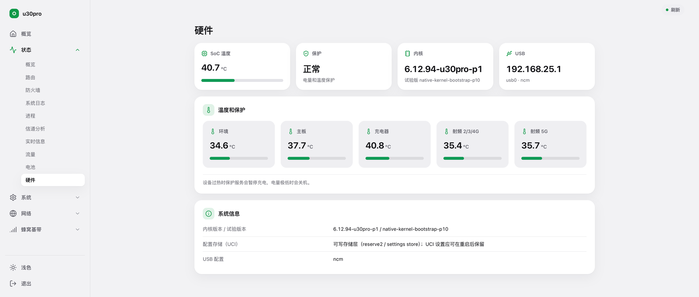
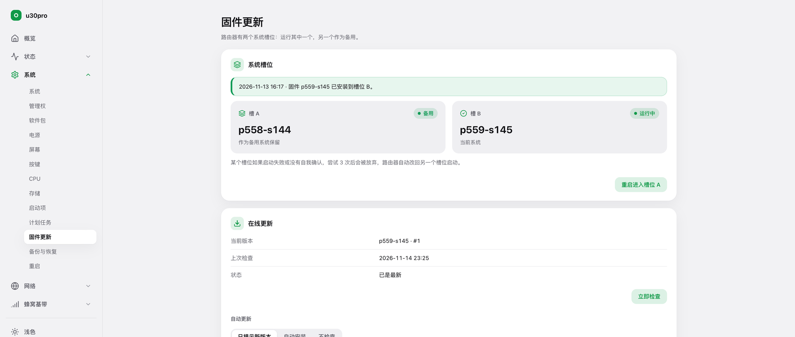
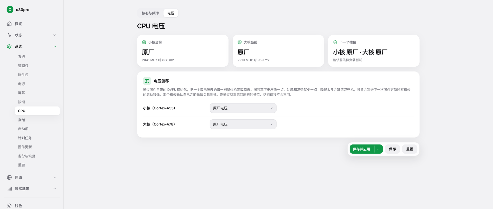
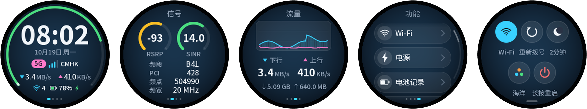

# firmware

[中文](#中文) | [English](#english)

## 中文

自制设备固件的发布仓库。

| 目录 | 设备 |
|---|---|
| `mu5250/` | 中兴 U60 Pro（MU5250），OpenWrt 固件 |
| `mu5358/` | 中兴 U30 Pro（MU5358），OpenWrt 固件 |

- `mu5250/` 的固件文件名：`mu5250-openwrt-<日期>.enc`，同一天的第二版起加 `-2`、`-3`……；`.delta-*` 是从某个旧版本升级用的增量包。
- `mu5358/` 的固件文件名：`mu5358-openwrt-<版本>-a.enc`、`-b.enc`，分别是写入 A 槽、B 槽的完整包（运行 B 槽的设备用 `-a`，运行 A 槽的用 `-b`）。
- 每个目录的 `index.enc` 是更新索引，设备的在线更新读它。
- 旧版本一直保留，不会删除。

### U30 Pro 截图

网页（LuCI，中文界面）：

| 概览 | 硬件与内核 |
|---|---|
|  |  |
| **固件更新与在线更新** | **CPU 电压** |
|  |  |

机身圆形触屏：

更多图片在 [`screenshots/mu5358/`](screenshots/mu5358/)。网页截图来自真机，Wi-Fi 名称和壁纸已替换；屏幕截图由屏幕程序的模拟器渲染，数据是模拟的。

版权所有，保留一切权利。未经许可不得复制、再分发、修改或出售，详见 [LICENSE](LICENSE)。

## English

Release repository for custom device firmware.

| Folder | Device |
|---|---|
| `mu5250/` | ZTE U60 Pro (MU5250), OpenWrt firmware |
| `mu5358/` | ZTE U30 Pro (MU5358), OpenWrt firmware |

- In `mu5250/`, firmware files are named `mu5250-openwrt-<date>.enc`; a second build on the same day gets `-2`, then `-3`, and so on. `.delta-*` files are incremental updates from an older build.
- In `mu5358/`, firmware files are named `mu5358-openwrt-<version>-a.enc` and `-b.enc`: full packages for slot A and slot B (a device running slot B takes `-a`, one running slot A takes `-b`).
- `index.enc` in each folder is the update index the devices' online update reads.
- Older versions are kept and never deleted.

### U30 Pro screenshots

Web interface (LuCI, Chinese):

| Overview | Hardware and kernel |
|---|---|
|  |  |
| **Firmware update and online update** | **CPU voltage** |
|  |  |

The round touch screen:

More in [`screenshots/mu5358/`](screenshots/mu5358/). The web screenshots are from a real device with the Wi-Fi name and wallpaper replaced; the screen shots are rendered by the screen program's simulator with simulated data.

Copyright, all rights reserved. No copying, redistribution, modification or sale without permission; see [LICENSE](LICENSE).
